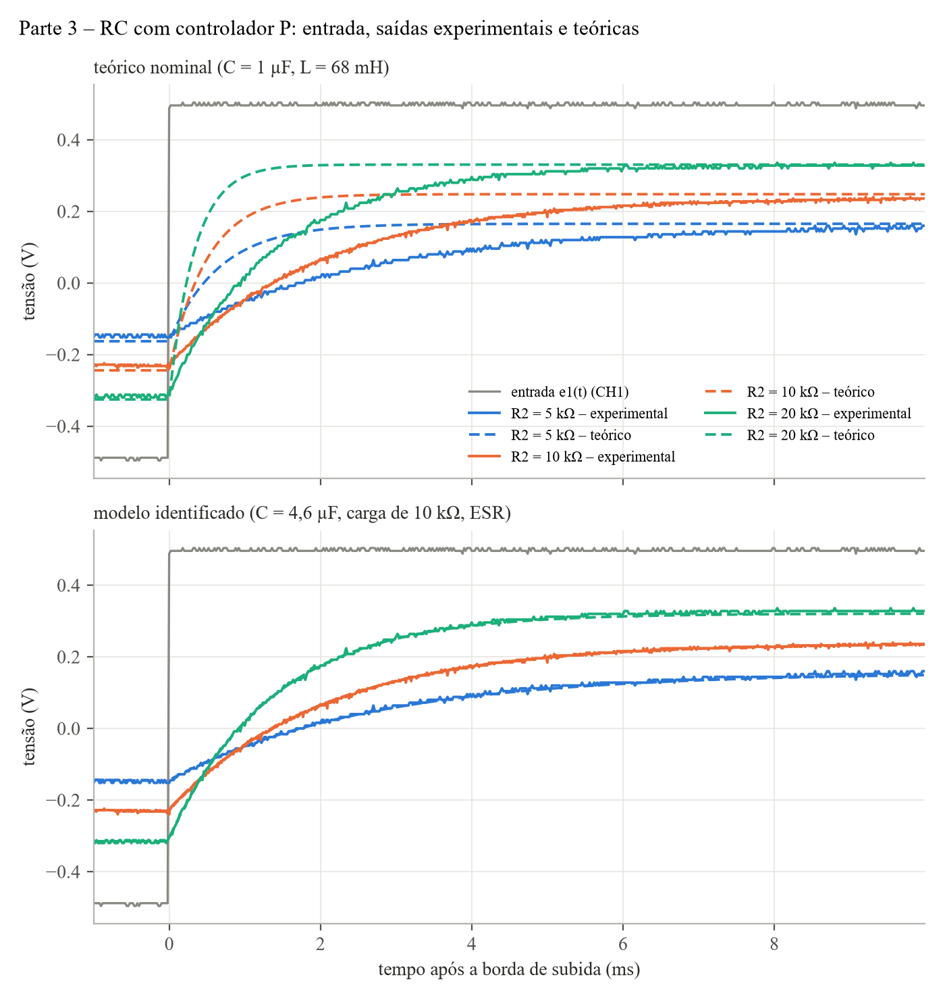
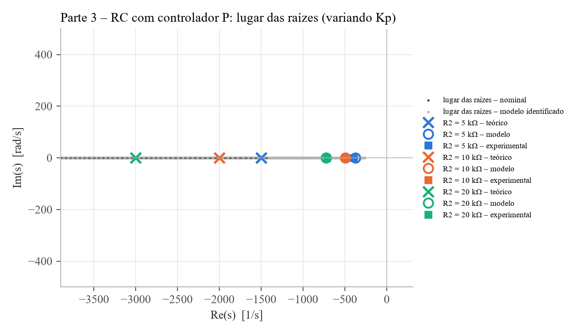
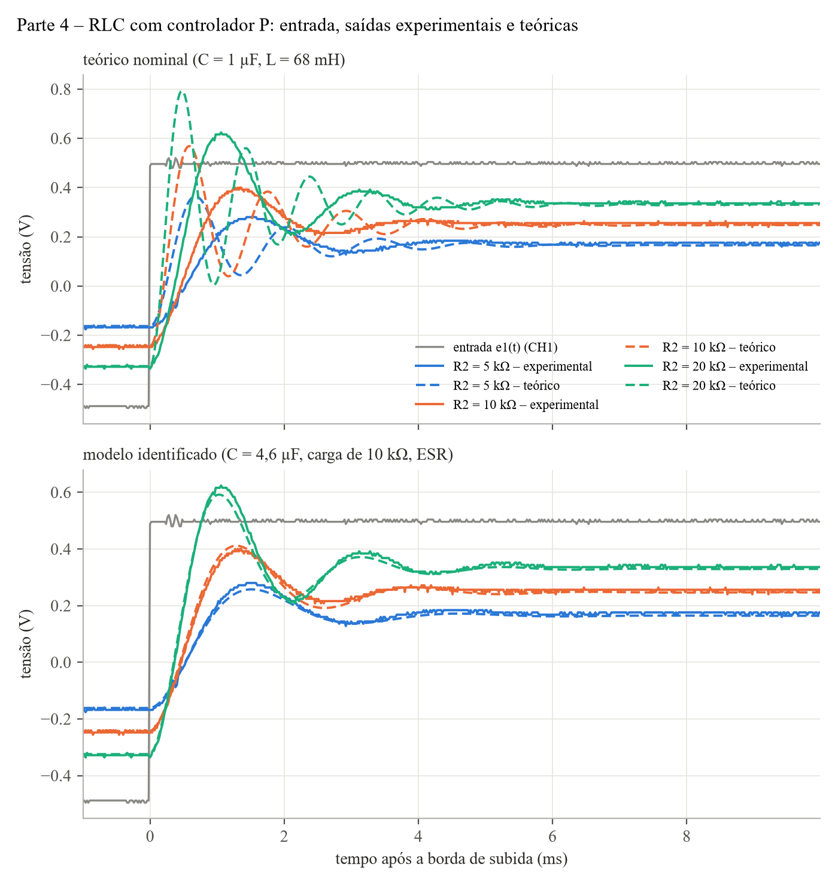
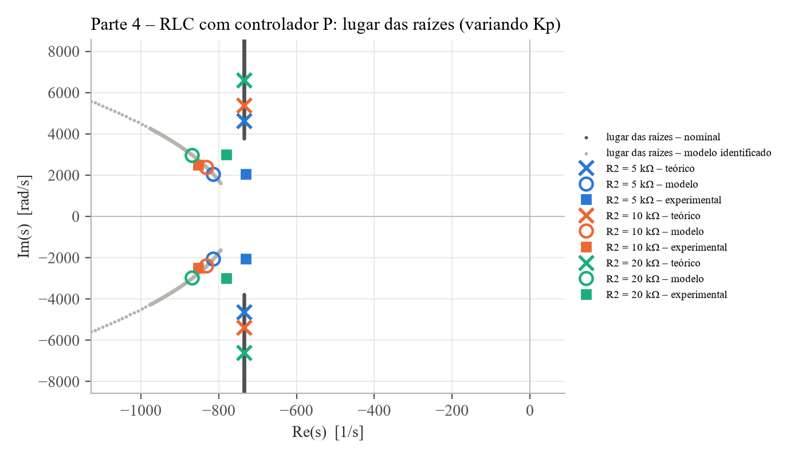
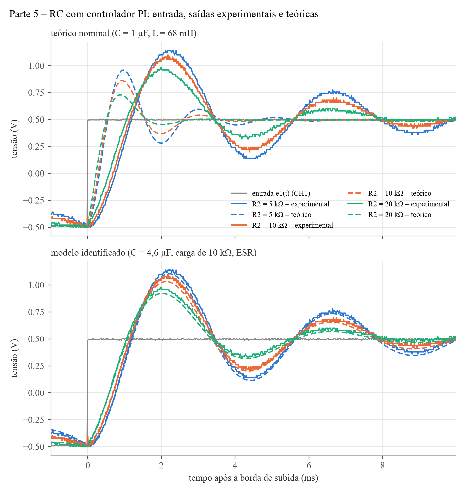
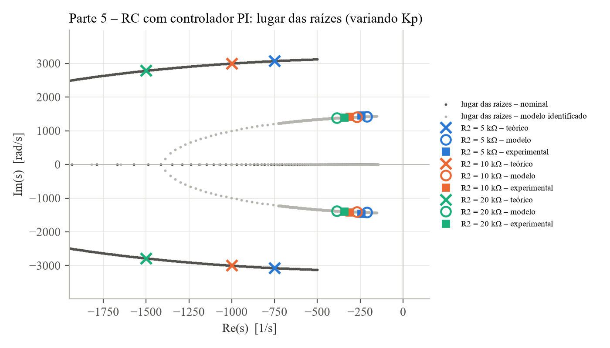
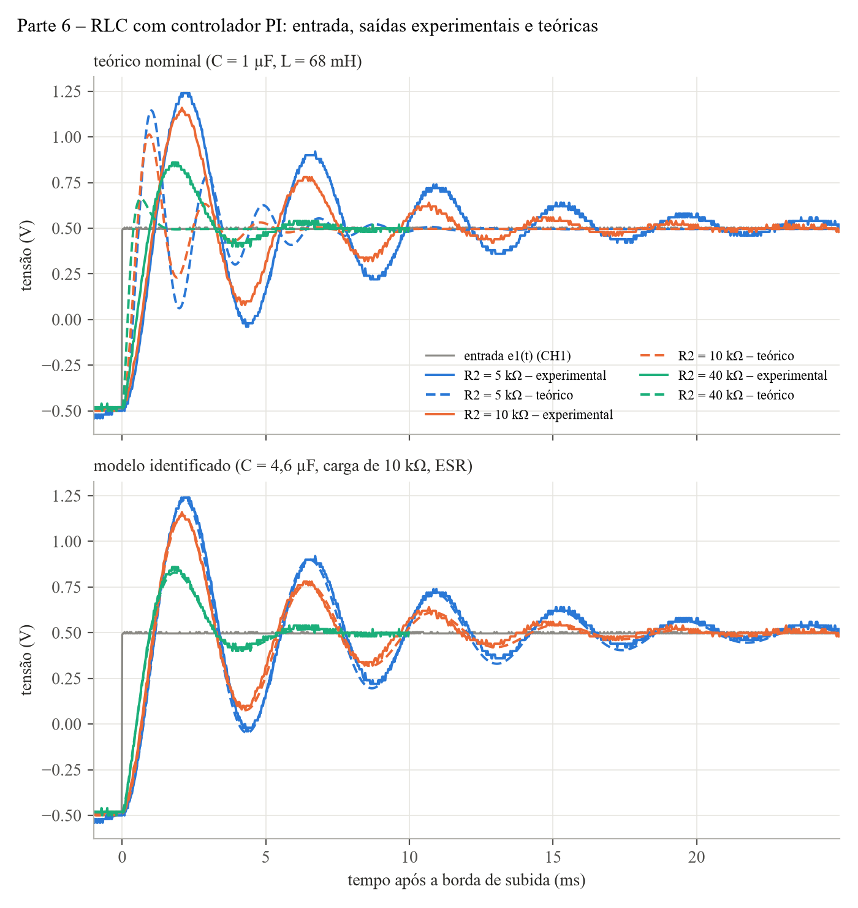
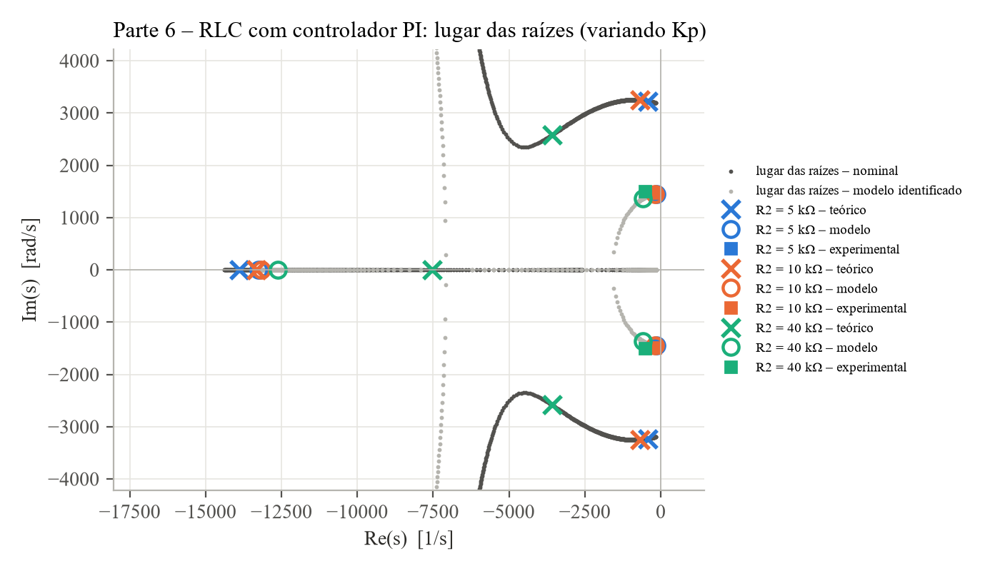

# Experimento 6: análise dos dados (Controlador P e PI)

Osciloscópio Tektronix TBS1052B, CSVs de `E:\NEW_FOLHHH\ALL0000` … `ALL0025`. CH1 = entrada e₁(t) (onda quadrada de 1 Vpp) e CH2 = tensão no capacitor V_c(t). Roteiro e teoria: "Instrumentação e Controle – Experimento 6 Prática" e "Experimento 6 Teoria", na Biblioteca do painel.

**Indutor.** O roteiro indica L = 77 mH, mas o indutor foi medido com **68 mH**. Todos os valores teóricos das Partes 4 e 6 usam 68 mH. A versão anterior deste relatório usava 77 mH; ela está guardada em `_antigo/`.

## Resumo

1. **O regime permanente concorda com a teoria nas quatro partes.** Com P, e_ss = 1/(1+K_p) e nunca zera; com PI, e_ss = 0.
2. **A dinâmica é cerca de 2× mais lenta em frequência do que a teórica**, em todas as partes. A causa é o capacitor: as formas de onda fixam R₁·C ≈ 4,2 ms e L·C ≈ 3,1·10⁻⁷ s², o que dá C entre 4,2 e 4,6 µF, e não 1 µF.
3. **Com L = 68 mH sobra uma inconsistência de 10 %.** Para as Partes 3 e 4 fecharem com o mesmo capacitor, ou R₁ vale 0,91 kΩ (com L = 68 mH), ou L vale 75 mH no circuito (com R₁ = 1,00 kΩ). As formas de onda não separam os dois cenários; uma medida de C, de R₁ ou da resistência da bobina separa.
4. **Dois efeitos fora do modelo do roteiro aparecem nos dados:** o resistor de 10 kΩ da realimentação carrega o capacitor, e o capacitor tem perto de 5 Ω de resistência série.
5. **Um único modelo com esses componentes reproduz as 12 formas de onda** com resíduo perto da resolução do osciloscópio. A Parte 6 foi prevista sem nenhum ajuste feito nela.

## Mapeamento das capturas

| Parte | R₂ = 5 kΩ | R₂ = 10 kΩ | R₂ = 20 kΩ / 40 kΩ | Obs. |
|---|---|---|---|---|
| 3 – RC, P | 0, 1 | 2, 3 | 20k: 4, 5 | 50 Hz |
| 4 – RLC, P | 10, 11 | 8, 9 | 20k: 6, 7 | 50 Hz |
| 5 – RC, PI | 16, 17 | 14, 15 | **20k**: 12, 13 | 50 Hz. O roteiro pede 40k, mas foi medido com 20k (o K_p ajustado dá ≈ 2,1) |
| 6 – RLC, PI | 18, 19 | 20, 21 | 40k: 24, 25 | 5k e 10k em **20 Hz**; 40k em 50 Hz |

As capturas 22/23 (anotadas como "4k") foram **descartadas**: CH2 fica em ≈ 0 V no semiciclo negativo e tem picos de ±4 V nas bordas, o que é incompatível com o circuito (provável saturação ou erro de ligação).

## Método

**Medidas.** Cada valor experimental é a média de todas as bordas completas (subida e descida espelhada) das duas capturas do caso, com média móvel de 60 µs no CH2. Critérios:
- T_r de 10–90 % na 1ª ordem e de 0–100 % nos sistemas subamortecidos;
- T_s pelo critério de 2 %; quando a resposta não acomoda dentro do meio período, a tabela mostra "> meio período";
- V_c é metade da excursão de regime do CH2. A amplitude da entrada é A = 0,492 V (patamares em −0,488 V e +0,496 V).

**ζ, ω_n e ω_d experimentais, por dois métodos.**
- *Método do roteiro* (colunas "exp" das Tabelas 3, 5 e 7): ζ = −ln M_p / √(π² + ln² M_p), ω_d = π/T_p e ω_n = ω_d/√(1−ζ²). Vale para o 2ª ordem padrão partindo do repouso.
- *Decremento logarítmico* (colunas "decr."): extremos sucessivos da oscilação ficam π/ω_d separados e caem por e^(−σπ/ω_d). O método mede σ e ω_d direto da oscilação, e por isso não é afetado por zeros, por um terceiro polo rápido ou por a resposta não partir do repouso.

**Três níveis de modelo.**
- *Teórico:* valores do roteiro com L = 68 mH (C = 1 µF, C_f = 10 nF, R = 10 kΩ), planta ideal.
- *Modelo identificado:* os mesmos circuitos com os componentes que as formas de onda fixam (seção seguinte). É um só para os 12 casos.
- *Ganhos ajustados por caso:* K_p (e K_i) que melhor reproduzem cada caso, usados como "K_p e K_i experimentais".

**Resolução.** Intervalo de amostragem de 10 ou 20 µs, conforme a captura. Passo de quantização (LSB) de 4 a 8 mV nas Partes 3 e 4 e de 20 mV nas Partes 5 e 6. Diferenças menores que isso não são conclusivas.

## Modelo comum aos quatro circuitos

O 1º amp-op soma e₁ com −V_c (o 3º amp-op é um inversor de ganho 1), formando o erro. O 2º amp-op aplica G_c(s) = Z₂(s)/R e desfaz a inversão. O resultado é uma **realimentação unitária negativa**:

$$\frac{V_c(s)}{E_1(s)} = \frac{G_c(s)\,G(s)}{1 + G_c(s)\,G(s)}$$

- P: G_c = K_p = R₂/R, com R = 10 kΩ
- PI: G_c = K_p + K_i/s, com K_i = 1/(R·C_f) = **10⁴ s⁻¹**
- RC: G = 1/(R₁Cs + 1). RLC: G = 1/(LCs² + R₁Cs + 1)

---

## O que os dados fixam sobre os componentes

### 1. O capacitor vale entre 4,2 e 4,6 µF, e não 1 µF

Os valores de regime batem com a teoria, mas toda a dinâmica é mais lenta: τ fica ≈ 4× maior na Parte 3 e ω_n fica ≈ 0,46× a teórica nas Partes 4 a 6. A razão é a mesma para todos os K_p, então o desvio está na planta, e não no controlador.

Cada parte só enxerga **produtos** de componentes:

| Parte | O que a forma de onda fixa | Valor |
|---|---|---|
| 3 | R₁·C (constante de tempo) | 4,2 ms |
| 4 | L·C (frequência natural) e (R₁ + R_série)/L (amortecimento) | 3,13·10⁻⁷ s² e ≈ 1580 s⁻¹ |
| 5 | R₁·C/K_i (frequência natural) | 4,8·10⁻⁷ s² |

Para virar valor de componente é preciso uma âncora, e as duas âncoras disponíveis dão leituras diferentes:

| Âncora | C | L | R₁ (1 kΩ) | R série extra | R₁·C | L·C |
|---|---|---|---|---|---|---|
| L = 68 mH (medido) | 4,60 µF | 68 mH | 0,91 kΩ | 6,7 Ω | 4,18 ms | 3,13·10⁻⁷ s² |
| R₁ = 1,00 kΩ (nominal) | 4,19 µF | 74,6 mH | 1,00 kΩ | 17,0 Ω | 4,19 ms | 3,13·10⁻⁷ s² |

As duas reproduzem as formas de onda igualmente bem, porque os produtos são os mesmos. O que muda é qual componente "paga" a diferença:
- com L = 68 mH, o resistor de 1 kΩ teria de valer 0,91 kΩ, fora da tolerância de 5 %;
- com R₁ = 1,00 kΩ, o indutor teria de valer ≈ 75 mH no circuito, perto dos 77 mH do roteiro.

Este relatório segue a primeira leitura, porque L foi o componente medido. Em qualquer das duas, a conclusão sobre o capacitor não muda: ele é um componente de ≈ 4,7 µF nominal (ou um eletrolítico com tolerância larga), e não de 1 µF.

### 2. O resistor de 10 kΩ da realimentação carrega o capacitor

No esquema do roteiro, V_c vai ao amp-op inversor por um resistor R = 10 kΩ ligado a um terra virtual. Para a planta, isso é uma carga de 10 kΩ em paralelo com C:

$$G_{RC}(s) = \frac{1}{R_1C\,s + 1 + R_1/R}, \qquad G_{RLC}(s) = \frac{1}{LC\,s^2 + (R_1C + L/R)\,s + 1 + R_1/R}$$

O ganho estático da planta deixa de ser 1 e passa a R/(R + R₁): **0,91** com R₁ = 1 kΩ e 0,99 com R₁ = 100 Ω. Na Parte 3 isso explica por que o K_p tirado do regime parecia ≈ 10 % baixo (0,45 / 0,91 / 1,94); dividindo por 0,917, ele vira 0,49 / 0,99 / 2,11. Com PI o efeito some no regime, porque o integrador compensa.

### 3. O capacitor tem ≈ 5 Ω de resistência série (hipótese)

Nas partes com PI, o K_p que melhor reproduz cada forma de onda fica sempre 0,1 a 0,3 acima do nominal (0,71 / 1,17 / 2,11 na Parte 5). Um desvio aditivo, e não proporcional a R₂, não é tolerância de resistor. Uma resistência série r no capacitor (ESR) produz esse efeito: no laço com integrador, ela soma K_i·r·C ao termo de amortecimento, exatamente como um K_p maior.

Ajustando r e K_i comuns aos três casos da Parte 5, com K_p nominal: **r = 5,0 Ω** e **K_i = 8719 s⁻¹** (C_f ≈ 11,5 nF, dentro da tolerância). O termo K_i·r·C vale 0,20, o desvio observado. Com P a ESR quase não aparece (muda τ em menos de 1 %), o que explica ela não ter sido vista na Parte 3.

A ESR não foi medida diretamente; outra fonte de amortecimento com o mesmo efeito não está descartada.

### Modelo identificado e resíduos

| Componente | Nominal | Identificado | Origem |
|---|---|---|---|
| C | 1 µF | 4,60 µF | Parte 4 (ω_n), com L = 68 mH |
| R série extra no ramo RLC | 0 | 6,7 Ω | Parte 4 (σ); inclui bobina e ESR |
| R₁ de 1 kΩ | 1,00 kΩ | 0,909 kΩ | Parte 3 (τ); só R₁·C é observável |
| K_i = 1/(R·C_f) | 10 000 s⁻¹ | 8719 s⁻¹ | Parte 5 |
| ESR do capacitor | 0 | 5,0 Ω | Parte 5 (amortecimento a mais) |
| Carga sobre C | ∞ | 10 kΩ | esquema (resistor R do inversor) |

Resíduo RMS entre o CH2 medido e cada modelo, em mV. Nenhum parâmetro foi ajustado na Parte 6, então a coluna "+ K_i comum e ESR" é uma previsão para ela.

| Caso | LSB | Teórico nominal | Planta identificada | + K_i comum e ESR | Ganhos ajustados por caso |
|---|---|---|---|---|---|
| Parte 3, R₂ = 5 kΩ | 6 | 80,3 | 3,9 | 4,1 | 3,4 |
| Parte 3, R₂ = 10 kΩ | 4 | 108,7 | 3,1 | 3,0 | 3,0 |
| Parte 3, R₂ = 20 kΩ | 8 | 117,6 | 5,9 | 5,5 | 5,9 |
| Parte 4, R₂ = 5 kΩ | 6 | 80,6 | 10,1 | 9,6 | 5,1 |
| Parte 4, R₂ = 10 kΩ | 8 | 117,4 | 12,4 | 11,0 | 11,9 |
| Parte 4, R₂ = 20 kΩ | 8 | 161,8 | 10,0 | 12,3 | 9,8 |
| Parte 5, R₂ = 5 kΩ | 20 | 361,0 | 162,0 | 25,5 | 25,2 |
| Parte 5, R₂ = 10 kΩ | 20 | 301,8 | 108,5 | 25,7 | 25,4 |
| Parte 5, R₂ = 20 kΩ | 20 | 225,6 | 61,9 | 24,3 | 23,6 |
| Parte 6, R₂ = 5 kΩ | 20 | 290,6 | 162,5 | 27,2 | 19,0 |
| Parte 6, R₂ = 10 kΩ | 20 | 226,4 | 77,5 | 24,4 | 14,5 |
| Parte 6, R₂ = 40 kΩ | 20 | 175,6 | 30,6 | 14,9 | 12,4 |

O modelo identificado sai de 80–360 mV de erro para 3–27 mV, da ordem do LSB. Nas figuras de resposta, o painel de cima compara o experimento com o teórico e o de baixo com esse modelo.

---

## Parte 3: RC com controlador P

**Função de transferência**

$$\frac{V_c}{E_1} = \frac{K_p}{R_1C\,s + 1 + K_p} = \frac{K_p/(1+K_p)}{\tau s + 1}, \qquad \tau = \frac{R_1C}{1+K_p}, \qquad p = -\frac{1+K_p}{R_1C}$$

Com R₁C = 1 ms: T_r = 2,2τ, T_s = 4τ e V_c = 0,5·K_p/(1+K_p).

**Tabela 1**

| C = 1 µF, R₁ = 1 kΩ | τ exp | τ teo | T_r exp | T_r teo | T_s exp | T_s teo | V_c exp | V_c teo |
|---|---|---|---|---|---|---|---|---|
| R₂ = 5 kΩ | 2,53 ms | 0,67 ms | 5,31 ms | 1,47 ms | 8,5 ms | 2,67 ms | 0,152 V | 0,167 V |
| R₂ = 10 kΩ | 2,01 ms | 0,50 ms | 4,38 ms | 1,10 ms | 7,5 ms | 2,00 ms | 0,234 V | 0,250 V |
| R₂ = 20 kΩ | 1,40 ms | 0,33 ms | 3,10 ms | 0,73 ms | 5,6 ms | 1,33 ms | 0,325 V | 0,333 V |

**Erro estacionário e K_p.** e_ss = (A − V_c)/A. K = V_c/(A − V_c) é o ganho de malha visto pelo regime, igual a K_p·G(0).

| R₂ | e_ss teo | e_ss exp | K_p teo | K = V_c/(A − V_c) | G(0) do modelo | K_p = K/G(0) | K_p do ajuste |
|---|---|---|---|---|---|---|---|
| 5 kΩ | 66,7 % | 69,0 % | 0,50 | 0,449 | 0,917 | 0,49 | 0,51 |
| 10 kΩ | 50,0 % | 52,4 % | 1,00 | 0,908 | 0,917 | 0,99 | 0,99 |
| 20 kΩ | 33,3 % | 34,0 % | 2,00 | 1,939 | 0,917 | 2,11 | 2,00 |

**Polos** (s⁻¹)

| R₂ | teórico | experimental (−1/τ) | modelo identificado |
|---|---|---|---|
| 5 kΩ | −1500 | −395 | −377 |
| 10 kΩ | −2000 | −497 | −495 |
| 20 kΩ | −3000 | −717 | −727 |




### O que dava para concluir

**Pela teoria do roteiro**
- **e_ss = 1/(1+K) se confirma:** 69 % / 52 % / 34 % medidos contra 67 % / 50 % / 33 %. O erro cai com K_p e nunca zera, como previsto para K finito.
- **O controlador P não acrescenta polos nem zeros:** a resposta continua de 1ª ordem, exponencial e sem sobressinal.
- **A frase "o tempo de acomodação aumenta e o sistema fica mais oscilatório" não vale aqui.** T_s caiu de 8,5 para 5,6 ms com o aumento de K_p, e não há oscilação. A teoria diz "em geral" e "em certos casos"; a planta de 1ª ordem é o caso em que P melhora regime e transitório ao mesmo tempo.
- **Lugar das raízes:** há um único polo real em s = −(1+K_p)/(R₁C), que anda para a esquerda com K_p. O sistema é estável para qualquer K_p > −1.

**Com teoria extra**
- **A carga de 10 kΩ corrige o regime.** Com G(0) = 0,917, o erro previsto é 1/(1 + 0,917·K_p) = 68,6 % / 52,2 % / 35,3 %, e o K_p recuperado fica em 0,49 / 0,99 / 2,11. No caso de 20 kΩ, a diferença entre os dois modelos é de 1 LSB, então ali não é conclusivo.
- **Só o produto R₁·C é observável.** A razão τ_exp/τ_teo é a mesma para os três K_p (3,8 a 4,2), o que aponta para a planta. O ajuste dá R₁·C = 4,2 ms, mas uma planta de 1ª ordem não distingue "C maior" de "R₁ maior". Quem resolve é a Parte 4, que usa outro resistor e fixa L·C.
- **O K_p do ajuste da forma de onda (0,51 / 0,99 / 2,00) bate com R₂/R.** Isso valida os resistores do controlador e confirma que o desvio de regime vinha da carga.
- **A ESR não é visível aqui**, porque só altera τ em menos de 1 %.

---

## Parte 4: RLC com controlador P

**Função de transferência**

$$\frac{V_c}{E_1} = \frac{K_p}{LC\,s^2 + R_1C\,s + 1 + K_p} = \frac{K\,\omega_n^2}{s^2 + 2\zeta\omega_n s + \omega_n^2}$$

$$\omega_n = \sqrt{\frac{1+K_p}{LC}}, \qquad \zeta = \frac{R_1}{2}\sqrt{\frac{C}{L(1+K_p)}}, \qquad K = \frac{K_p}{1+K_p}$$

A parte real dos polos é σ = ζω_n = R₁/(2L) = **735 s⁻¹** com L = 68 mH, independente de K_p. Logo T_s ≈ 4/σ = 5,4 ms nos três casos. As demais métricas: T_r = (π − arccos ζ)/ω_d, T_p = π/ω_d e M_p = e^(−ζπ/√(1−ζ²)).

**Tabela 2** (L = 68 mH, C = 1 µF, R₁ = 100 Ω)

| | T_r exp | T_r teo | T_p exp | T_p teo | M_p exp | M_p teo | T_s exp | T_s teo | V_c exp | V_c teo |
|---|---|---|---|---|---|---|---|---|---|---|
| R₂ = 5 kΩ | 0,93 ms | 0,37 ms | 1,47 ms | 0,68 ms | 31,1 % | 60,8 % | 5,5 ms | 5,4 ms | 0,171 V | 0,167 V |
| R₂ = 10 kΩ | 0,80 ms | 0,32 ms | 1,28 ms | 0,58 ms | 31,7 % | 65,1 % | 4,8 ms | 5,4 ms | 0,253 V | 0,250 V |
| R₂ = 20 kΩ | 0,62 ms | 0,25 ms | 1,09 ms | 0,48 ms | 42,4 % | 70,5 % | 5,4 ms | 5,4 ms | 0,334 V | 0,333 V |

**Tabela 3** (ω em rad/s; "exp" pelo método do roteiro)

| | ζ exp | ζ teo | ω_n exp | ω_n teo | ω_d exp | ω_d teo |
|---|---|---|---|---|---|---|
| R₂ = 5 kΩ | 0,348 | 0,157 | 2272 | 4697 | 2130 | 4639 |
| R₂ = 10 kΩ | 0,343 | 0,136 | 2613 | 5423 | 2454 | 5373 |
| R₂ = 20 kΩ | 0,263 | 0,111 | 2994 | 6642 | 2889 | 6601 |

Conferência pelo decremento logarítmico, ao lado do modelo identificado (σ em s⁻¹):

| | ζ decr. | ζ modelo | ω_d decr. | ω_d modelo | σ decr. | σ modelo | σ teo |
|---|---|---|---|---|---|---|---|
| R₂ = 5 kΩ | 0,336 | 0,370 | 2051 | 2042 | 730 | 814 | 735 |
| R₂ = 10 kΩ | 0,322 | 0,328 | 2490 | 2395 | 853 | 832 | 735 |
| R₂ = 20 kΩ | 0,251 | 0,280 | 3001 | 2979 | 780 | 868 | 735 |

**Erro estacionário e K_p**

| R₂ | e_ss teo | e_ss exp | K_p teo | K = V_c/(A − V_c) | G(0) do modelo | K_p = K/G(0) | K_p do ajuste |
|---|---|---|---|---|---|---|---|
| 5 kΩ | 66,7 % | 65,3 % | 0,50 | 0,532 | 0,990 | 0,54 | 0,54 |
| 10 kΩ | 50,0 % | 48,5 % | 1,00 | 1,062 | 0,990 | 1,07 | 1,02 |
| 20 kΩ | 33,3 % | 32,0 % | 2,00 | 2,121 | 0,990 | 2,14 | 2,02 |

**Funções de transferência obtidas dos gráficos** (K = V_c/A, com ζ e ω_n da Tabela 3), comparadas com as teóricas:

| R₂ | T_exp(s) | T_teo(s) |
|---|---|---|
| 5 kΩ | 1,79·10⁶ / (s² + 1582 s + 5,16·10⁶) | 7,35·10⁶ / (s² + 1471 s + 22,06·10⁶) |
| 10 kΩ | 3,52·10⁶ / (s² + 1794 s + 6,83·10⁶) | 14,71·10⁶ / (s² + 1471 s + 29,41·10⁶) |
| 20 kΩ | 6,09·10⁶ / (s² + 1576 s + 8,97·10⁶) | 29,41·10⁶ / (s² + 1471 s + 44,12·10⁶) |

**Polos** (s⁻¹)

| R₂ | K_p | teóricos | modelo identificado |
|---|---|---|---|
| 5 kΩ | 0,5 | −735 ± j4639 | −814 ± j2042 |
| 10 kΩ | 1,0 | −735 ± j5373 | −832 ± j2395 |
| 20 kΩ | 2,0 | −735 ± j6601 | −868 ± j2979 |




### O que dava para concluir

**Pela teoria do roteiro**
- **e_ss = 1/(1+K) se confirma** (65 % / 49 % / 32 %) e não zera.
- **"O aumento de K torna o sistema mais oscilatório" se confirma:** M_p sobe de 31 % para 42 %, ζ cai de 0,35 para 0,26 e ω_d sobe.
- **"O tempo de acomodação aumenta" não se confirma:** T_s fica em ≈ 5 ms nos três casos (5,5 / 4,8 / 5,4 ms), igual ao previsto 4/σ = 5,4 ms. Com L = 68 mH esse acordo é melhor do que era com 77 mH (6,2 ms).
- **"Podendo instabilizá-lo" não acontece nesta planta:** os polos sobem na vertical sobre Re(s) = −R₁/(2L) e nunca cruzam o eixo imaginário. O compromisso é entre erro (K_p alto) e sobressinal (K_p baixo).
- **O coeficiente em s do denominador experimental (1576 a 1794) fica perto do teórico R₁/L = 1471**, enquanto o termo constante fica 4 a 5× menor. Só o termo que depende de C está errado.

**Com teoria extra**
- **Dois invariantes separam os componentes.** σ só depende de (R₁ + R_série)/L, e ω_n² = (1 + K_p)/(LC) só depende de L·C. A razão ω_n exp/teo vale 0,45 a 0,48 nos três casos, igual a 1/√4,6 = 0,47. O ζ medido é 2,2 a 2,5× o teórico: √4,6 = 2,1 vem do capacitor e o resto da resistência série extra. Por isso o sobressinal medido (31–42 %) é metade do previsto (61–70 %).
- **Com L = 68 mH, C sai 4,60 µF.** É 10 % acima dos 4,2 µF que a Parte 3 daria com R₁ = 1,00 kΩ. Essa é a inconsistência descrita na seção de componentes.
- **A resistência série extra depende de qual L é o certo.** O σ medido (média de 790 s⁻¹) dá R_total = 2Lσ ≈ 107 Ω com 68 mH, ou seja, só ≈ 7 Ω além de R₁, dos quais ≈ 5 Ω seriam a ESR. Sobram ≈ 2 Ω para a bobina. Com L ≈ 75 mH sobrariam ≈ 12 Ω. Medir a resistência da bobina com o multímetro decide entre as duas leituras.
- **No modelo com ESR o lugar das raízes deixa de ser vertical.** A ESR soma K_p·r·C ao amortecimento, então σ cresce levemente com K_p (814 → 868 s⁻¹). Os pontos experimentais não têm resolução para confirmar essa tendência.
- **O K_p de regime fica ≈ 7 % acima de R₂/R** (0,54 / 1,07 / 2,14). Isso equivale a ≈ 7 mV em V_c, menos de 1 LSB; cabe também na tolerância dos resistores.
- **Aqui o método do roteiro para ζ é confiável**, porque a malha é um 2ª ordem puro: ele concorda com o decremento dentro de 7 %.

---

## Parte 5: RC com controlador PI

**Função de transferência**

$$\frac{V_c}{E_1} = \frac{K_p s + K_i}{R_1C\,s^2 + (1+K_p)\,s + K_i}, \qquad \omega_n = \sqrt{\frac{K_i}{R_1C}} = 3162\ \text{rad/s (fixo)}, \qquad \zeta = \frac{1+K_p}{2\sqrt{K_i R_1 C}}$$

Há também um zero em s = −K_i/K_p. Por causa dele, as métricas teóricas da Tabela 4 vêm da **resposta ao degrau exata da FT**, partindo do repouso, e não das fórmulas do 2ª ordem padrão.

**Tabela 4** (C = 1 µF, R₁ = 1 kΩ, C_f = 10 nF)

| | T_r exp | T_r teo | T_p exp | T_p teo | M_p exp | M_p teo | T_s exp | T_s teo | V_c exp | V_c teo |
|---|---|---|---|---|---|---|---|---|---|---|
| R₂ = 5 kΩ | 1,18 ms | 0,54 ms | 2,21 ms | 0,97 ms | 69,4 % | 47,0 % | > 10 ms | 5,2 ms | 0,466 V* | 0,500 V |
| R₂ = 10 kΩ | 1,14 ms | 0,52 ms | 2,10 ms | 0,94 ms | 60,2 % | 37,1 % | > 10 ms | 3,4 ms | 0,485 V* | 0,500 V |
| R₂ = 20 kΩ | 1,08 ms | 0,50 ms | 2,04 ms | 0,89 ms | 46,5 % | 23,6 % | 8,9 ms | 2,4 ms | 0,500 V | 0,500 V |

\* A oscilação ainda não tinha se extinguido no fim do semiperíodo (10 ms), então o "valor final" medido é aproximado.

**Tabela 5** ("exp" pelo método do roteiro)

| | ζ exp | ζ teo | ω_n exp | ω_n teo | ω_d exp | ω_d teo |
|---|---|---|---|---|---|---|
| R₂ = 5 kΩ | 0,116 | 0,237 | 1428 | 3162 | 1418 | 3072 |
| R₂ = 10 kΩ | 0,159 | 0,316 | 1512 | 3162 | 1492 | 3000 |
| R₂ = 20 kΩ | 0,237 | 0,474 | 1583 | 3162 | 1538 | 2784 |

Conferência pelo decremento logarítmico, ao lado do modelo identificado:

| | ζ decr. | ζ modelo | ω_n decr. | ω_d decr. | ω_d modelo | σ decr. | σ modelo |
|---|---|---|---|---|---|---|---|
| R₂ = 5 kΩ | 0,165 | 0,148 | 1476 | 1455 | 1422 | 244 | 212 |
| R₂ = 10 kΩ | 0,214 | 0,189 | 1457 | 1423 | 1410 | 312 | 271 |
| R₂ = 20 kΩ | 0,238 | 0,270 | 1439 | 1397 | 1379 | 343 | 387 |

**Erro estacionário, K_p e K_i.** Os ganhos experimentais vêm do ajuste de cada caso à forma de onda, com a planta identificada (sem ESR).

| R₂ | e_ss exp | K_p teo | K_p ajuste | K_i teo | K_i ajuste |
|---|---|---|---|---|---|
| 5 kΩ | 5,3 %* | 0,50 | 0,71 | 10 000 | 8641 |
| 10 kΩ | 1,4 %* | 1,00 | 1,17 | 10 000 | 8625 |
| 20 kΩ | −1,6 % ≈ 0 | 2,00 | 2,11 | 10 000 | 8594 |

**Polos** (s⁻¹)

| R₂ | K_p | teóricos | modelo identificado |
|---|---|---|---|
| 5 kΩ | 0,5 | −750 ± j3072 | −212 ± j1422 |
| 10 kΩ | 1,0 | −1000 ± j3000 | −271 ± j1410 |
| 20 kΩ | 2,0 | −1500 ± j2784 | −387 ± j1379 |




### O que dava para concluir

**Pela teoria do roteiro**
- **A ação integral elimina o erro estacionário.** No caso que acomodou (20 kΩ), V_c = 0,500 V; o desvio de −1,6 % é menor que 1 LSB (20 mV = 4 % de 0,5 V). O sistema passou do tipo 0 para o tipo 1.
- **"Prejudica o transitório, pois acrescenta polos" se confirma.** A mesma planta, que com P era de 1ª ordem e sem sobressinal (T_s de 5,6 a 8,5 ms), agora é de 2ª ordem, oscila com M_p de 47 a 69 % e leva 9 ms ou mais para acomodar.
- **"A ação proporcional melhora a resposta transitória" se confirma.** ω_n não depende de K_p, então aumentar K_p só aumenta ζ: o sobressinal cai de 69 % para 47 %.
- **O PI adiciona um polo na origem e um zero em −K_i/K_p** (−20 000, −10 000 e −5 000 s⁻¹ nominais).
- **Lugar das raízes:** com K_i fixo, os polos percorrem uma circunferência de raio ω_n em direção ao eixo real conforme K_p cresce, e ficam reais a partir de ζ = 1. O sistema é estável para qualquer K_p ≥ 0.

**Com teoria extra**
- **ω_n constante é um teste direto do modelo.** ω_n = √(K_i/(R₁C)) não depende de K_p, e o medido pelo decremento fica em 1476 / 1457 / 1439 rad/s (variação de 3 %). Esse valor fixa R₁·C/K_i = 4,8·10⁻⁷ s². Com R₁·C = 4,2 ms da Parte 3, sai K_i ≈ 8700 s⁻¹, isto é, C_f ≈ 11,5 nF.
- **O M_p medido não é o de um degrau partindo do repouso.** A 50 Hz o meio período (10 ms) é menor que T_s, então cada borda começa com resto da oscilação anterior. No modelo identificado com R₂ = 5 kΩ, o sobressinal é 63 % partindo do repouso e 73 % em regime periódico; o medido foi 69 %.
- **Por isso o método do roteiro subestima ζ aqui.** Aplicado à saída simulada do modelo com R₂ = 5 kΩ, ele devolve ζ = 0,10 para um sistema com ζ = 0,15. O decremento devolve 0,15. Os valores "decr." são a melhor estimativa experimental de ζ nesta parte: 0,17 / 0,21 / 0,24.
- **A ESR explica o K_p "a mais".** K_i·r·C = 0,20 entra somado a (1 + K_p) no amortecimento, e os ajustes por caso deram K_p 0,21 / 0,17 / 0,11 acima do nominal. Com r = 5 Ω e K_p nominal, o resíduo fica igual ao do ajuste por caso (≈ 25 mV), com um parâmetro em vez de três.
- **O resíduo de ≈ 25 mV é o piso desta medida:** o LSB é 20 mV, porque o canal estava em 0,5 V/div.
- **Projeto.** Para ζ = 0,7 seria preciso K_p ≈ 3,5 com os valores nominais (R₂ ≈ 35 kΩ; os 40 kΩ do roteiro dariam ζ ≈ 0,79). Com os componentes identificados, seria K_p ≈ 7,4 (R₂ ≈ 75 kΩ). Os 20 kΩ usados dão ζ ≈ 0,27. A outra saída é reduzir K_i com um C_f maior.

---

## Parte 6: RLC com controlador PI

**Função de transferência** (3ª ordem)

$$\frac{V_c}{E_1} = \frac{K_p s + K_i}{LC\,s^3 + R_1C\,s^2 + (1+K_p)\,s + K_i}$$

**Routh.** A malha é estável se R₁C(1+K_p) > LC·K_i, ou seja, 1 + K_p > L·K_i/R₁ = **0,68** com L = 68 mH. Isso vale para qualquer K_p ≥ 0. As métricas teóricas vêm da resposta ao degrau exata, e ζ, ω_n e ω_d são os do **par dominante**.

**Polos** (s⁻¹)

| R₂ | K_p | teóricos | modelo identificado |
|---|---|---|---|
| 5 kΩ | 0,5 | −13880; −413 ± j3229 | −13257; −137 ± j1444 |
| 10 kΩ | 1,0 | −13327; −689 ± j3250 | −13171; −198 ± j1442 |
| 40 kΩ | 4,0 | −7542; −3582 ± j2582 | −12619; −583 ± j1368 |

**Tabela 6** (C = 1 µF, L = 68 mH, R₁ = 1 kΩ, C_f = 10 nF)

| | T_r exp | T_r teo | T_p exp | T_p teo | M_p exp | M_p teo | T_s exp | T_s teo | V_c exp | V_c teo |
|---|---|---|---|---|---|---|---|---|---|---|
| R₂ = 5 kΩ (20 Hz) | 1,19 ms | 0,55 ms | 2,12 ms | 1,00 ms | 68,4 % | 66,0 % | > 25 ms | 9,0 ms | 0,529 V* | 0,500 V |
| R₂ = 10 kΩ (20 Hz) | 1,12 ms | 0,52 ms | 2,07 ms | 0,94 ms | 65,4 % | 52,6 % | 21,2 ms | 5,1 ms | 0,497 V | 0,500 V |
| R₂ = 40 kΩ (50 Hz) | 0,97 ms | 0,39 ms | 1,86 ms | 0,65 ms | 36,4 % | 16,9 % | 7,3 ms | 1,3 ms | 0,494 V | 0,500 V |

\* Ainda oscilando no fim do semiperíodo.

**Tabela 7** ("exp" pelo método do roteiro)

| | ζ exp | ζ teo | ω_n exp | ω_n teo | ω_d exp | ω_d teo |
|---|---|---|---|---|---|---|
| R₂ = 5 kΩ | 0,120 | 0,127 | 1490 | 3255 | 1480 | 3229 |
| R₂ = 10 kΩ | 0,134 | 0,208 | 1531 | 3322 | 1518 | 3250 |
| R₂ = 40 kΩ | 0,306 | 0,811 | 1774 | 4416 | 1689 | 2582 |

Conferência pelo decremento logarítmico, ao lado do modelo identificado:

| | ζ decr. | ζ modelo | ω_n decr. | ω_d decr. | ω_d modelo | σ decr. | σ modelo |
|---|---|---|---|---|---|---|---|
| R₂ = 5 kΩ | 0,097 | 0,094 | 1449 | 1442 | 1444 | 141 | 137 |
| R₂ = 10 kΩ | 0,133 | 0,136 | 1495 | 1482 | 1442 | 199 | 198 |
| R₂ = 40 kΩ | 0,326 | 0,392 | 1589 | 1502 | 1368 | 518 | 583 |

**Erro estacionário, K_p e K_i** (ajuste por caso, com a planta identificada)

| R₂ | e_ss exp | K_p teo | K_p ajuste | K_i teo | K_i ajuste |
|---|---|---|---|---|---|
| 5 kΩ | −7,5 %* | 0,50 | 0,72 | 10 000 | 8531 |
| 10 kΩ | −1,0 % ≈ 0 | 1,00 | 1,27 | 10 000 | 8969 |
| 40 kΩ | −0,5 % ≈ 0 | 4,00 | 4,18 | 10 000 | 8875 |




### O que dava para concluir

**Pela teoria do roteiro**
- **O erro estacionário foi eliminado de novo** (tipo 1): −1,0 % e −0,5 % nos casos que acomodaram, abaixo de 1 LSB.
- **"Com o aumento da ordem, acrescentam-se possibilidades de instabilidade" se confirma em parte.** O sistema agora é de 3ª ordem e existe uma condição de Routh, que não havia nas Partes 3 a 5. Com R₁ = 1 kΩ ela é satisfeita para qualquer K_p ≥ 0, então não se viu instabilidade.
- **K_p maior melhora o amortecimento:** M_p cai de 68 % para 36 % e T_s de mais de 25 ms para 7 ms. Com K_p baixo o par dominante fica colado no eixo imaginário, e por isso foi preciso baixar a frequência para 20 Hz.
- **Lugar das raízes:** com K_p pequeno, o polo real é rápido (≈ −13 000 s⁻¹) e o par complexo domina. Com K_p crescente, o par se afasta do eixo imaginário e o polo real se aproxima da origem.

**Com teoria extra**
- **Por que o roteiro troca R₁ de 100 Ω para 1 kΩ.** A condição de Routh é R₁(1+K_p) > L·K_i e não depende de C. Com R₁ = 100 Ω ela exigiria K_p > 5,8, e os três valores da tabela dariam uma malha instável.
- **A Parte 6 é a Parte 5 com um deslocamento desestabilizante.** Como R₁/L ≈ 13 000 s⁻¹ é muito maior que ω_n, o indutor age como um atraso pequeno, que move o par dominante para a direita em L·ω_n²/(2R₁) ≈ 78 s⁻¹. O modelo mostra isso: σ cai de 212 para 137 s⁻¹ (5 kΩ) e de 271 para 198 s⁻¹ (10 kΩ). Os medidos caem de 244 para 141 e de 312 para 199 s⁻¹. O limite de Routh é o ponto em que esse deslocamento iguala o σ da Parte 5.
- **Validação do modelo identificado.** Nenhum parâmetro foi ajustado nesta parte, e mesmo assim o resíduo fica em 15 a 27 mV, com LSB de 20 mV. O ζ previsto para 5 kΩ e 10 kΩ (0,094 e 0,136) bate com o decremento (0,097 e 0,133).
- **No circuito real o modelo de par dominante vale melhor do que a teoria nominal sugere.** Com K_p = 4, os polos nominais (−7542 e −3582 ± j2582) têm influência comparável. No modelo identificado, o polo real fica em −12 600 s⁻¹ e o par em −583 ± j1368, bem separados.
- **O acordo de M_p em 5 kΩ (68,4 % contra 66,0 %) é coincidência.** T_p e ω_n diferem por um fator 2. Os ζ só ficam parecidos (0,13 teórico e 0,09 a 0,12 medido) porque dois efeitos se compensam: o capacitor maior reduz ζ, e o deslocamento causado pelo indutor, que cresce com ω_n², pesa bem menos no circuito real (78 s⁻¹) do que no nominal (340 s⁻¹).
- **Em 40 kΩ o método do roteiro subestima ζ** (0,31 contra 0,39 no modelo), porque o zero em −K_i/K_p ≈ −2200 s⁻¹ fica perto do par dominante e aumenta o sobressinal.

---

## Conclusões

1. **Controlador P** (Partes 3 e 4): o erro estacionário cai com K_p [e_ss = 1/(1+K_p)], mas nunca zera. Na planta de 1ª ordem, K_p só acelera a resposta. Na de 2ª ordem, K_p aumenta o sobressinal sem mudar T_s.
2. **Controlador PI** (Partes 5 e 6): a ação integral zera o erro estacionário, aumenta a ordem do sistema e introduz oscilação. Nesse caso, aumentar K_p melhora o amortecimento.
3. **As afirmações gerais da teoria sobre o P** ("aumenta o tempo de acomodação", "pode instabilizar") não se aplicam a estas duas plantas ideais. O que se observa é: nenhuma piora na 1ª ordem e só mais sobressinal na 2ª.
4. **Os valores de regime concordam com a teoria** dentro de 1 LSB, depois de considerada a carga de 10 kΩ sobre o capacitor.
5. **A dinâmica mais lenta vem do capacitor**, que vale entre 4,2 e 4,6 µF. Com L = 68 mH, o modelo que fecha as quatro partes tem C = 4,60 µF, R₁ = 0,91 kΩ, K_i = 8719 s⁻¹ e ESR de 5 Ω.
6. **A medida de 68 mH melhora o T_s teórico da Parte 4**, mas deixa R₁ 9 % abaixo do nominal. As formas de onda são igualmente compatíveis com L ≈ 75 mH e R₁ = 1,00 kΩ.

## Medidas que fechariam as dúvidas

| Medida | Se der… | Então… |
|---|---|---|
| Capacitor C | ≈ 4,6 µF | L = 68 mH se sustenta e R₁ ≈ 0,91 kΩ |
| | ≈ 4,2 µF | L no circuito é ≈ 75 mH |
| Resistor R₁ de 1 kΩ | ≈ 0,91 kΩ | confirma a leitura com L = 68 mH |
| Resistência CC da bobina | ≈ 2 Ω | compatível com L = 68 mH |
| | ≈ 12 Ω ou mais | compatível com L ≈ 75 mH |
| ESR do capacitor (ou tan δ) | ≈ 5 Ω | confirma a hipótese do amortecimento extra |

Se o indutor foi medido em uma frequência bem acima da faixa de oscilação do experimento (230 a 480 Hz), vale repetir a medida perto dessa faixa.

## Como reproduzir

```
labscope/         biblioteca reutilizável (não depende deste experimento)
experimento6.py   componentes, mapa de capturas e análise deste experimento
testes/           testes da biblioteca e regressão contra _antigo/tabelas.json
_antigo/          scripts e resultados da versão com L = 77 mH
```

```bash
python experimento6.py E:\NEW_FOLHHH
```

Gera `tabelas.json`, `tabelas.md` (as tabelas deste relatório) e `figs/*.png`. O valor de L está em `Comp.L`, em `experimento6.py`.

```bash
python -m pytest testes
```
