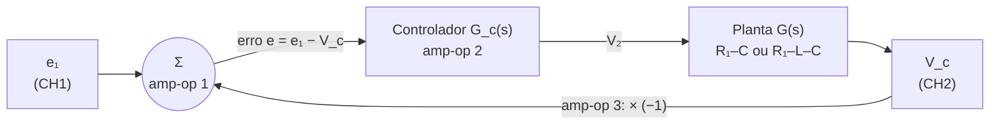

# Experimento 6: de onde vêm as funções de transferência

Este texto deduz, passo a passo, a função de transferência dos quatro circuitos do roteiro e explica o papel de cada amp-op. Ele parte do zero: só assume circuitos básicos (Kirchhoff e impedâncias). Os resultados medidos estão em [analise_experimento6.md](analise_experimento6.md).

Os valores numéricos usam os componentes do roteiro, com o indutor medido: R = 10 kΩ, C = 1 µF, C_f = 10 nF e **L = 68 mH**.

## 1. O mínimo para acompanhar

**Impedâncias em s.** Trocar d/dt por s transforma equações diferenciais em álgebra. Cada componente vira uma "resistência" que depende de s:

| Componente | Impedância |
|---|---|
| Resistor | R |
| Indutor | sL |
| Capacitor | 1/(sC) |

Com isso, divisor de tensão e lei dos nós valem do mesmo jeito que em corrente contínua.

**Função de transferência (FT).** É a razão saída/entrada em s, por exemplo V_c(s)/E₁(s). Dois usos práticos:
- colocando **s = 0** obtém-se o ganho em regime permanente (o que sobra depois que tudo acomoda);
- as raízes do denominador são os **polos**, que dizem como a resposta evolui no tempo. Um polo real em −a gera um termo e^(−at). Um par complexo −σ ± jω_d gera uma oscilação de frequência ω_d que decai como e^(−σt). Polo com parte real positiva significa sistema instável.

**Amp-op ideal com realimentação negativa.** Duas regras bastam:
1. não entra corrente nas entradas;
2. a saída se ajusta até a entrada (−) ficar no mesmo potencial da entrada (+).

Nos três amp-ops do circuito, a entrada (+) está no terra. Pela regra 2, a entrada (−) fica em 0 V: é o **terra virtual**.

**Amplificador inversor.** Com uma impedância Z_in da fonte até a entrada (−) e Z_f da saída até a entrada (−):

```
            Z_f
        ┌───▭───┐
        │       │
Vin ─▭──┴─(−)   │
    Z_in     >──┴── Vout
      ┌──(+)
     GND
```

A corrente que chega por Z_in é V_in/Z_in (o outro lado está em 0 V). Pela regra 1, ela toda segue por Z_f. Somando as correntes no nó (−):

$$\frac{V_{in}}{Z_{in}} + \frac{V_{out}}{Z_f} = 0 \quad\Rightarrow\quad V_{out} = -\frac{Z_f}{Z_{in}}\,V_{in}$$

Todo o circuito do experimento é feito de variações dessa conta.

## 2. Visão geral: três amp-ops, uma malha

Nomes usados aqui, pela posição na figura do roteiro:

| Amp-op | Onde está na figura                          | Saída | Função                                  |
| ------ | -------------------------------------------- | ----- | --------------------------------------- |
| 1      | em cima, à esquerda (recebe e₁)              | V₁    | somador: calcula o erro                 |
| 2      | em cima, à direita (tem R₂ na realimentação) | V₂    | controlador: P ou PI                    |
| 3      | embaixo (recebe V_c)                         | V₃    | inversor: leva −V_c de volta ao somador |

Depois do amp-op 2 vem a **planta**, que é a parte passiva: R₁–C ou R₁–L–C. A saída é a tensão no capacitor, V_c.



A ideia de controle em malha fechada é esta: mede-se a saída, compara-se com o que se quer (a entrada e₁), e o controlador age sobre a planta com base na diferença, o **erro**.

## 3. O papel de cada amp-op

### Amp-op 3: inversor da realimentação

V_c chega à entrada (−) por um resistor R, e há outro R na realimentação. É o inversor com Z_in = Z_f = R:

$$V_3 = -\frac{R}{R}\,V_c = -V_c$$

**Para que serve.** O somador (amp-op 1) só sabe somar. Para obter e₁ − V_c, é preciso entregar a ele −V_c. Sem este estágio o circuito somaria e₁ + V_c, a realimentação seria positiva e a saída iria direto para a saturação.

### Amp-op 1: somador (detector de erro)

Chegam à entrada (−) três resistores iguais a R: um vindo de e₁, um vindo de V₃ e o da realimentação. Somando as correntes no terra virtual:

$$\frac{E_1}{R} + \frac{V_3}{R} + \frac{V_1}{R} = 0 \quad\Rightarrow\quad V_1 = -(E_1 + V_3)$$

Substituindo V₃ = −V_c:

$$V_1 = -(E_1 - V_c) = -E$$

**Para que serve.** Ele calcula o erro E = E₁ − V_c. O sinal sai invertido, e o próximo estágio desfaz isso.

### Amp-op 2: controlador

É outro inversor, com Z_in = R e, na realimentação, uma impedância Z₂ que muda conforme o controlador:

$$V_2 = -\frac{Z_2}{R}\,V_1 = -\frac{Z_2}{R}\,(-E) = \frac{Z_2}{R}\,E \quad\Rightarrow\quad G_c(s) = \frac{V_2}{E} = \frac{Z_2(s)}{R}$$

**Controlador P** (Figuras 1 e 2): Z₂ = R₂.

$$G_c = \frac{R_2}{R} = K_p$$

A ação é proporcional ao erro. Com R = 10 kΩ, R₂ de 5, 10, 20 e 40 kΩ dão K_p de 0,5, 1, 2 e 4.

**Controlador PI** (Figuras 3 e 4): Z₂ = R₂ em série com C_f.

$$Z_2 = R_2 + \frac{1}{sC_f} \quad\Rightarrow\quad G_c = \frac{R_2}{R} + \frac{1}{R\,C_f\,s} = K_p + \frac{K_i}{s}, \qquad K_i = \frac{1}{R\,C_f} = 10^4\ \text{s}^{-1}$$

No tempo, dividir por s é integrar:

$$v_2(t) = K_p\,e(t) + K_i\int_0^t e(\tau)\,d\tau$$

Fisicamente, a corrente e/R que entra pelo terra virtual vai carregando C_f. Enquanto houver erro, a tensão em C_f continua crescendo e a saída continua subindo. Ela só para de mudar quando o erro é exatamente zero. É por isso que o PI elimina o erro de regime.

**Para que serve.** Além de aplicar G_c, o amp-op 2:
- desfaz a inversão do amp-op 1, de modo que V₂ tem o mesmo sinal do erro;
- alimenta a planta como fonte de tensão de baixa impedância, então a planta pode ser analisada sozinha, como um divisor de tensão.

## 4. A planta

A planta é um divisor de tensão entre a impedância série e o capacitor, alimentado por V₂.

**RC** (Partes 3 e 5):

$$G(s) = \frac{V_c}{V_2} = \frac{\dfrac{1}{sC}}{R_1 + \dfrac{1}{sC}} = \frac{1}{R_1C\,s + 1}$$

Tem um polo em −1/(R₁C). Sozinha, responde a um degrau com uma exponencial de constante de tempo R₁C e chega ao valor da entrada (G(0) = 1).

**RLC** (Partes 4 e 6):

$$G(s) = \frac{\dfrac{1}{sC}}{R_1 + sL + \dfrac{1}{sC}} = \frac{1}{LC\,s^2 + R_1C\,s + 1}$$

Tem dois polos. Com R₁ pequeno eles são complexos e a planta oscila na troca de energia entre L e C.

## 5. Fechando a malha

Do diagrama, a saída é o erro passando pelo controlador e pela planta:

$$V_c = G_c\,G\,(E_1 - V_c)$$

Isolando V_c:

$$V_c\,(1 + G_c G) = G_c G\,E_1 \quad\Rightarrow\quad \boxed{\frac{V_c}{E_1} = \frac{G_c\,G}{1 + G_c\,G}}$$

Na prática: escreve-se G_c·G como fração N(s)/D(s), e a malha fechada é N/(D + N). O numerador se mantém e o denominador ganha o numerador somado.

## 6. Os quatro circuitos

### Parte 3: RC com P

$$G_cG = \frac{K_p}{R_1C\,s + 1} \quad\Rightarrow\quad \frac{V_c}{E_1} = \frac{K_p}{R_1C\,s + 1 + K_p}$$

Dividindo em cima e embaixo por (1 + K_p), aparece a forma padrão de 1ª ordem K/(τs + 1):

$$\frac{V_c}{E_1} = \frac{\dfrac{K_p}{1+K_p}}{\dfrac{R_1C}{1+K_p}\,s + 1}, \qquad \tau = \frac{R_1C}{1+K_p}, \qquad \text{polo: } s = -\frac{1+K_p}{R_1C}$$

Como ler:
- **1ª ordem:** resposta exponencial, sem sobressinal. T_r ≈ 2,2τ e T_s ≈ 4τ.
- **Ganho de regime** K_p/(1+K_p), sempre menor que 1. A saída nunca chega à entrada.
- **K_p maior** deixa a resposta mais rápida (τ menor) e o ganho mais perto de 1.

Exemplo, R₂ = 10 kΩ (K_p = 1), R₁C = 1 ms: V_c/E₁ = 0,5/(0,0005 s + 1). Para um degrau de 0,5 V, a saída vai a 0,25 V com τ = 0,5 ms.

### Parte 4: RLC com P

$$G_cG = \frac{K_p}{LC\,s^2 + R_1C\,s + 1} \quad\Rightarrow\quad \frac{V_c}{E_1} = \frac{K_p}{LC\,s^2 + R_1C\,s + 1 + K_p}$$

Dividindo por LC e comparando com a forma padrão de 2ª ordem:

$$\frac{V_c}{E_1} = \frac{K_p/(LC)}{s^2 + \dfrac{R_1}{L}\,s + \dfrac{1+K_p}{LC}} \;=\; \frac{K\,\omega_n^2}{s^2 + 2\zeta\omega_n\,s + \omega_n^2}$$

Igualando termo a termo:

$$\omega_n = \sqrt{\frac{1+K_p}{LC}}, \qquad 2\zeta\omega_n = \frac{R_1}{L} \;\Rightarrow\; \zeta = \frac{R_1}{2}\sqrt{\frac{C}{L\,(1+K_p)}}, \qquad K = \frac{K_p}{1+K_p}$$

Os polos são s = −σ ± jω_d, com σ = ζω_n = R₁/(2L) e ω_d = ω_n√(1 − ζ²).

Como ler:
- **ω_n** (frequência natural) dá a rapidez da oscilação; **ζ** (amortecimento) dá o quanto ela é contida. ζ < 1 oscila; quanto menor, maior o sobressinal: M_p = e^(−ζπ/√(1−ζ²)).
- **K_p maior** aumenta ω_n e diminui ζ: oscila mais rápido e com mais sobressinal.
- **σ = R₁/(2L) não depende de K_p**, então o tempo de acomodação T_s ≈ 4/σ é o mesmo nos três casos. Com L = 68 mH e R₁ = 100 Ω: σ = 735 s⁻¹ e T_s ≈ 5,4 ms.
- **Ganho de regime** igual ao da Parte 3: K_p/(1+K_p).

Exemplo, K_p = 1: 1/(LC) = 1,47·10⁷ e R₁/L = 1471, então V_c/E₁ = 1,47·10⁷/(s² + 1471 s + 2,94·10⁷). Daí ω_n = 5423 rad/s, ζ = 0,136 e polos em −735 ± j5373.

### Parte 5: RC com PI

Primeiro o controlador como uma fração só: G_c = K_p + K_i/s = (K_p s + K_i)/s.

$$G_cG = \frac{K_p s + K_i}{s\,(R_1C\,s + 1)} \quad\Rightarrow\quad \frac{V_c}{E_1} = \frac{K_p s + K_i}{R_1C\,s^2 + (1 + K_p)\,s + K_i}$$

Dividindo por R₁C e comparando o denominador com s² + 2ζω_n s + ω_n²:

$$\omega_n = \sqrt{\frac{K_i}{R_1C}}, \qquad \zeta = \frac{1+K_p}{2\sqrt{K_i\,R_1C}}, \qquad \text{zero: } s = -\frac{K_i}{K_p}$$

Como ler:
- **A ordem subiu de 1 para 2.** O integrador acrescentou um polo, e a mesma planta que não oscilava com P agora pode oscilar.
- **Ganho de regime igual a 1:** em s = 0 sobra K_i/K_i. A saída chega exatamente à entrada.
- **ω_n não depende de K_p.** Aumentar K_p só aumenta ζ, ou seja, amortece. É o contrário do que acontecia na Parte 4.
- **O zero** (raiz do numerador) não muda os polos, mas aumenta o sobressinal em relação ao 2ª ordem padrão. Por isso as fórmulas de M_p e T_p da Parte 4 são só aproximações aqui.

Exemplo, K_p = 1: V_c/E₁ = (1000 s + 10⁷)/(s² + 2000 s + 10⁷). Daí ω_n = 3162 rad/s, ζ = 0,316, polos em −1000 ± j3000 e zero em −10 000.

### Parte 6: RLC com PI

$$G_cG = \frac{K_p s + K_i}{s\,(LC\,s^2 + R_1C\,s + 1)} \quad\Rightarrow\quad \frac{V_c}{E_1} = \frac{K_p s + K_i}{LC\,s^3 + R_1C\,s^2 + (1 + K_p)\,s + K_i}$$

É de **3ª ordem**: três polos, sem fórmula fechada simples. Normalmente há um polo real rápido e um par complexo mais lento, o **par dominante**, que define a aparência da resposta. É dele que se tiram ζ, ω_n e ω_d.

**Estabilidade (critério de Routh).** Para um polinômio a₃s³ + a₂s² + a₁s + a₀ com todos os coeficientes positivos, os polos ficam todos no semiplano esquerdo se a₂·a₁ > a₃·a₀. Aqui:

$$R_1C\,(1+K_p) > LC\,K_i \quad\Rightarrow\quad 1 + K_p > \frac{L\,K_i}{R_1}$$

Com L = 68 mH, K_i = 10⁴ s⁻¹ e R₁ = 1 kΩ, o lado direito vale 0,68: a malha é estável para qualquer K_p ≥ 0. Com R₁ = 100 Ω valeria 6,8, e seria preciso K_p > 5,8. Essa é a razão de o roteiro usar R₁ = 1 kΩ nesta parte.

Como ler:
- **Ganho de regime igual a 1**, pelo mesmo motivo da Parte 5.
- **K_p maior** afasta o par dominante do eixo imaginário (mais amortecimento) e traz o polo real para perto da origem.
- É o primeiro circuito do experimento em que a instabilidade é possível.

Exemplo, K_p = 1: denominador 6,8·10⁻⁸ s³ + 10⁻³ s² + 2 s + 10⁴, com polos em −13 327 e −689 ± j3250.

## 7. Erro de regime: por que P deixa erro e PI não

O erro é E = E₁ − V_c. Usando a FT de malha fechada:

$$E = E_1 - \frac{G_cG}{1+G_cG}\,E_1 = \frac{1}{1 + G_cG}\,E_1$$

Para um degrau de amplitude A, o valor final se obtém com s = 0 (teorema do valor final):

$$e_{ss} = \frac{A}{1 + G_c(0)\,G(0)}$$

- **Com P:** G_c(0)·G(0) = K_p·1, então e_ss = A/(1 + K_p). É finito para qualquer K_p finito. Em porcentagem: 66,7 %, 50 % e 33,3 % para K_p de 0,5, 1 e 2.
- **Com PI:** G_c tem K_i/s, que tende a infinito quando s → 0. Então e_ss = 0.

O número de integradores (fatores 1/s) em G_c·G é o **tipo** do sistema. Tipo 0 deixa erro para degrau; tipo 1 zera.

Vale o raciocínio físico também. Com P, para manter V_c diferente de zero o controlador precisa de V₂ ≠ 0, e V₂ = K_p·e só existe se houver erro. Com PI, o integrador guarda o valor de V₂ necessário mesmo com erro nulo.

## 8. Um detalhe que o modelo ideal ignora

O resistor R que leva V_c ao amp-op 3 termina em um terra virtual. Para a planta, ele é uma carga de 10 kΩ em paralelo com o capacitor. Refazendo a conta do nó V_c na planta RC:

$$\frac{V_2 - V_c}{R_1} = sC\,V_c + \frac{V_c}{R} \quad\Rightarrow\quad G(s) = \frac{1}{R_1C\,s + 1 + R_1/R}$$

O ganho estático da planta passa de 1 para R/(R + R₁), que vale 0,91 com R₁ = 1 kΩ. Na FT de malha fechada basta trocar "1 + K_p" por "1 + R₁/R + K_p". Esse efeito aparece nas medidas da Parte 3 e está discutido no relatório de análise.

## 9. Resumo

| Parte | Planta | Controlador | V_c/E₁ | Ordem | Tipo | Ganho de regime |
|---|---|---|---|---|---|---|
| 3 | RC | P | K_p / (R₁C s + 1 + K_p) | 1 | 0 | K_p/(1+K_p) |
| 4 | RLC | P | K_p / (LC s² + R₁C s + 1 + K_p) | 2 | 0 | K_p/(1+K_p) |
| 5 | RC | PI | (K_p s + K_i) / (R₁C s² + (1+K_p) s + K_i) | 2 | 1 | 1 |
| 6 | RLC | PI | (K_p s + K_i) / (LC s³ + R₁C s² + (1+K_p) s + K_i) | 3 | 1 | 1 |

Valores teóricos com os componentes do roteiro e L = 68 mH:

| Parte | K_p | Polos (s⁻¹) | ζ | ω_n (rad/s) |
|---|---|---|---|---|
| 3 | 0,5 / 1 / 2 | −1500 / −2000 / −3000 | – | – |
| 4 | 0,5 / 1 / 2 | −735 ± j4639 / −735 ± j5373 / −735 ± j6601 | 0,157 / 0,136 / 0,111 | 4697 / 5423 / 6642 |
| 5 | 0,5 / 1 / 2 | −750 ± j3072 / −1000 ± j3000 / −1500 ± j2784 | 0,237 / 0,316 / 0,474 | 3162 |
| 6 | 0,5 / 1 / 4 | −13 880 e −413 ± j3229 / −13 327 e −689 ± j3250 / −7542 e −3582 ± j2582 | 0,127 / 0,208 / 0,811 | 3255 / 3322 / 4416 |

## 10. Vocabulário

| Termo | O que é |
|---|---|
| Polo | raiz do denominador da FT; define a forma da resposta no tempo |
| Zero | raiz do numerador; altera amplitude e sobressinal, não a estabilidade |
| Ordem | grau do denominador (quantos polos) |
| Tipo | quantos integradores há no caminho direto G_c·G |
| τ | constante de tempo de um polo real: tempo para chegar a 63 % |
| ω_n | frequência natural: módulo do par de polos complexos |
| ζ | coeficiente de amortecimento: 0 oscila para sempre, 1 ou mais não oscila |
| σ | parte real dos polos (ζω_n): taxa de decaimento da oscilação |
| ω_d | frequência amortecida: a frequência que se vê no osciloscópio |
| M_p | sobressinal: quanto o pico passa do valor final, em % do degrau |
| T_r, T_p, T_s | tempos de subida, de pico e de acomodação (faixa de 2 %) |
| e_ss | erro em regime permanente: entrada menos saída depois de acomodar |
| Lugar das raízes | caminho que os polos percorrem no plano s quando K_p varia |
